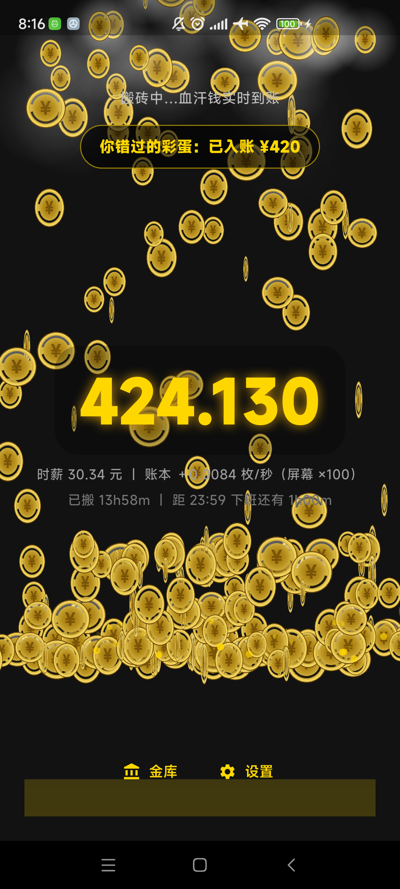
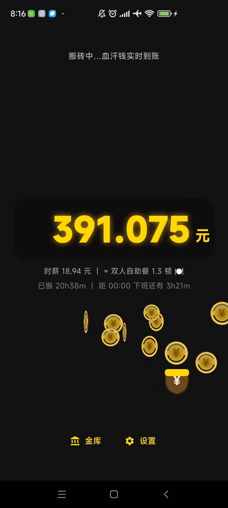

# GoldRainApp · 搬砖爆金币

> A mood-lifting app that turns your work into a real-time gold-coin shower. When your shift starts, coins flood the screen with every minute you work; when it ends, your daily "paycheck report" is auto-settled — so you literally watch your effort materialize.

[](LICENSE)
[](https://flutter.dev)
[](#)
[](#)

<p align="center">
  
  &nbsp;&nbsp;
  
</p>

---

## 📖 About

GoldRainApp breaks your abstract monthly salary into **coins that pop out in real time**, so you can actually *see* yourself earning while you work.

- **Zero clock-in anxiety**: you set your start/end times; coins start flowing automatically when the shift begins and settle automatically when it ends — no buttons to press.
- **Ledger vs. visuals are separate**: the ledger is strictly `1 yuan = 1 coin` (your report/vault show real money); a "visual multiplier" can boost on-screen density for flair without touching the ledger.
- **Purely local, zero privacy**: no network, no data collection, no accounts — everything is wiped when you uninstall.

---

## 🎮 Core Loop

```
Shift starts ──► coins flow in real time at your hourly rate (no action needed)
   │
   ├─ hourly coin rain, ×100 burst when you cross ¥100
   ├─ auto-collect: 15 coins on screen → sucked into a money bag
   └─ live purchasing power: spicy strips → noodles → milk tea → hotpot → iPhone…
Shift ends ──► auto settle, today's report goes to the vault
   └─ accumulate to unlock skins: gold coin / red packet / gold ingot
```

---

## ✨ Features

| Module | Description |
|---|---|
| **Hands-free coin shower** | Auto-calculated from your shift settings; amount ticks with 3 decimals; `CustomPainter` particle system with gravity, bounce, sparkle, floats, and screen shake |
| **Hourly-rate math** | `hourly rate = monthly salary ÷ workdays ÷ hours`; `coins/sec = hourly rate ÷ 3600` |
| **Purchasing power** | 11 tiers: spicy strips → luosifen → milk tea → BBQ → hotpot → buffet → AJ → AirPods → concert → PS5 → iPhone |
| **Hourly coin rain** | Big burst on every hour with a toast |
| **Egg surprises** | ×100 burst each time today's earnings cross a ¥100 mark; missed surprises auto-replay next launch |
| **Auto collect** | 15 coins on screen → money bag appears and sucks them in (visual only, ledger untouched) |
| **Skins** | 3 unlockable looks: gold coin (default) / red packet (¥100) / gold ingot (¥2000) |
| **Daily report** | Auto-settled at shift end: coins earned, hours worked, purchasing-power punchline |
| **Vault** | Cumulative total across all historical daily reports |
| **Finance planner** | Enter your take-home pay → 50/30/20 rule gives monthly + daily budgets |
| **Sound & haptics** | Coin ding, surge whoosh, light vibration — all toggleable in settings |
| **Dual flavors** | `prod` (official) and `demo` (separate package name, isolated data, side-by-side installable) |

---

## 🛠 Tech Highlights

- **Logic ↔ rendering split**: [`CoinEngine`](gold_rain/lib/engine/coin_engine.dart) produces numbers only; [`CoinField`](gold_rain/lib/render/coin_field.dart) paints them. Skins and effects don't interfere with the math.
- **Testable pure logic**: engine, shift logic, report copy, and local store are all plain Dart — **47 tests** passing under `flutter test`.
- **Performance**: no per-frame `setState`; `ValueNotifier` drives `CustomPaint(repaint:)`; `Paint` reuse, 96px sprites, skip repaint on idle frames, pause on background/screen-off.
- **Procedurally generated assets**: coin sprites, gold-ingot skin, and app icon are all generated by Python scripts (`assets/**/make_*.py`) — no external assets needed.
- **Tri-platform ready**: Android / iOS / Web directories generated; HarmonyOS NEXT toolchain researched (see [`docs/03-Project-Status.md`](docs/03-Project-Status.md)).

---

## 🚀 Quick Start

### Requirements

- Flutter SDK `^3.5.0`
- Dart SDK (bundled with Flutter)
- Android Studio (Android SDK) + device or emulator

### Run

```bash
cd gold_rain
flutter pub get
flutter run          # debug mode by default
```

### Build a Release APK

```bash
# Official build (app name "搬砖爆金币")
flutter build apk --flavor prod --release --split-per-abi

# Demo build (app name "搬砖爆金币·演示", data isolated from official)
flutter build apk --flavor demo --release --split-per-abi
```

> `--split-per-abi` builds per-architecture; the arm64 package is about 17 MB.

### Run Tests

```bash
flutter test
flutter analyze
```

---

## 📁 Project Structure

```
12_GoldRainApp/
├── gold_rain/                 # Flutter project
│   ├── lib/
│   │   ├── main.dart          # entry + global state machine
│   │   ├── theme.dart         # theme colors & common widgets
│   │   ├── engine/            # pure logic: coin engine / finance plan / report copy
│   │   ├── models/            # shift / settings / report data models
│   │   ├── render/            # particle field / skins / sound
│   │   ├── pages/             # home / rain / report / vault / finance / settings
│   │   └── store/             # local storage (shared_preferences)
│   ├── assets/                # icons / sprites / skins / sounds (+ generator scripts)
│   └── test/                  # 47 unit & widget tests
├── docs/                      # PRD / dev manual / project status / env setup
├── marketing/                 # promotional assets
└── 1_apk_files/               # archived release APKs
```

---

## 📚 Documentation

- [Product Requirements (PRD)](docs/01-PRD.md) — positioning, gameplay, formulas, milestones
- [Development Manual](docs/02-Dev-Manual.md) — M0–M4 walkthrough, core skeletons, pitfalls
- [Project Status & Handoff](docs/03-Project-Status.md) — latest version snapshot & tech decisions
- [Environment Setup](docs/04-M0-Env-Setup.md) — Flutter / Android SDK install checklist

---

## 📥 Download

Archived release APKs live in [`1_apk_files/`](1_apk_files). Latest:

- `搬砖爆金币-v0.6.23-arm64版-推荐.apk` — official arm64-v8a build
- `搬砖爆金币-演示版-v0.6.19-arm64.apk` — demo build (independent package, coexists with official)

> Built with Flutter's debug-signing key for evaluation only; configure your own signing for distribution.

---

## 🤝 Contributing

1. Fork this repo
2. Create a branch: `git checkout -b feat/xxx`
3. Commit: `git commit -m 'feat: xxx'`
4. Push: `git push origin feat/xxx`
5. Open a Pull Request

---

## 📄 License

This project is open-sourced under the [MIT License](LICENSE). Feel free to use, modify, and distribute.
