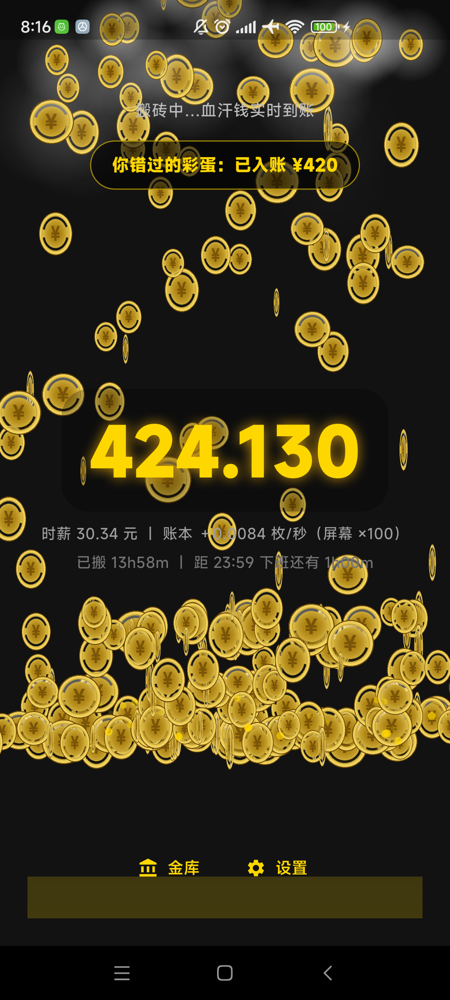
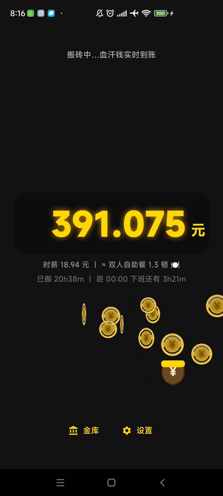

# 搬砖爆金币 · GoldRainApp

> 一款「上班即爆金币」的情绪价值 App：到了上班时间，金币自动随着你的每一分钟工作爆满屏幕，下班自动结算「今日工资战报」，让打工人亲眼看着自己的努力被可视化落地。

[](LICENSE)
[](https://flutter.dev)
[](#)
[](#)

<p align="center">
  
  &nbsp;&nbsp;
  
</p>

---

## 📖 项目简介

「搬砖爆金币」把抽象的月薪拆成**每秒实时爆出的金币**，让你上班时能直观地看到「我在赚钱」。

- **零打卡焦虑**：上班/下班时间由你设置，到点自动开始爆金币、下班自动收工入库，不需要点任何按钮。
- **账实分离**：账本严格 `1 元 = 1 枚金币`（战报/金库 = 真金白银）；屏幕出币密度可用「视觉倍率」放大，只管好看、不改账本。
- **纯本地、零隐私**：不联网、不采集任何个人数据、无账号系统，卸载即清零。

---

## 🎮 核心玩法

```
上班时间到 ──► 金币按你的时薪实时爆屏（无需操作）
   │
   ├─ 整点金币雨、跨 ¥100 彩蛋大爆发
   ├─ 攒够 15 颗自动收仓吸入钱袋
   └─ 实时购买力换算：辣条 → 螺蛳粉 → 奶茶 → 海底捞 → iPhone……
下班时间到 ──► 自动收工，今日战报入库
   └─ 累积进金库，解锁金币 / 红包 / 元宝皮肤
```

---

## ✨ 功能特性

| 模块 | 说明 |
|---|---|
| **免打卡金币爆屏** | 按设置的上下班时间自动推算，金币 3 位小数实时跳动；`CustomPainter` 粒子系统，含重力/弹跳/闪光/飘字/屏震 |
| **时薪换算** | 月薪 ÷ 月工作日 ÷ 日工时 = 时薪；每秒金币 = 时薪 ÷ 3600 |
| **购买力换算** | 11 档：辣条 / 螺蛳粉 / 奶茶 / 烧烤 / 海底捞 / 自助餐 / AJ / AirPods / 演唱会 / PS5 / iPhone，随金额实时升档 |
| **整点金币雨** | 每到整点触发一次大爆发 + 提示条 |
| **彩蛋爆发** | 今日收益每跨 ¥100 触发 ×100 大爆发；错过的彩蛋下次打开自动补放 |
| **自动收仓** | 屏幕攒够 15 颗金币，钱袋出现把金币吸入，纯视觉不动账本 |
| **皮肤系统** | 3 款可解锁皮肤：金币（默认）/ 红包（¥100）/ 元宝（¥2000） |
| **今日战报** | 下班自动结算：金币数、搬砖时长、购买力换算文案 |
| **金库** | 累计所有历史战报，查看每日收益曲线 |
| **理财规划** | 录入到手工资，按 50/30/20 法则给出月度 + 日均预算 |
| **音效 & 触觉** | 落地叮声、爆发唰声、金币爆出轻振动，均可在设置里关闭 |
| **双风味构建** | `prod` 正式版 / `demo` 演示版，包名不同、数据隔离、可并排安装 |

---

## 🛠 技术亮点

- **逻辑与渲染分离**：[`CoinEngine`](gold_rain/lib/engine/coin_engine.dart) 只产出数值，[`CoinField`](gold_rain/lib/render/coin_field.dart) 只负责画面，换肤加特效互不干扰。
- **纯逻辑可单测**：引擎、班次判断、战报文案、本地存储均为纯 Dart，`flutter test` 共 **47 个用例**全过。
- **性能优化**：去掉每帧 `setState`，改用 `ValueNotifier` 驱动 `CustomPaint(repaint:)`；复用 `Paint`、精灵按 96px 解码、静止帧跳过重绘、后台/息屏停表。
- **资源程序化生成**：金币精灵、元宝皮肤、App 图标均由 Python 脚本（`assets/**/make_*.py`）一键生成，无需外部素材。
- **三端工程就绪**：Android / iOS / Web 平台目录已生成；HarmonyOS NEXT 工具链已勘察（见 [`docs/03-Project-Status.md`](docs/03-Project-Status.md)）。

---

## 🚀 快速开始

### 环境要求

- Flutter SDK `^3.5.0`
- Dart SDK（随 Flutter）
- Android Studio（Android SDK）+ 真机或模拟器

### 运行

```bash
cd gold_rain
flutter pub get
flutter run          # 默认 debug 模式
```

### 打包 Release APK

```bash
# 正式版（应用名「搬砖爆金币」）
flutter build apk --flavor prod --release --split-per-abi

# 演示版（应用名「搬砖爆金币·演示」，数据与正式版隔离）
flutter build apk --flavor demo --release --split-per-abi
```

> `--split-per-abi` 按架构分包，arm64 包约 17MB。

### 跑测试

```bash
flutter test
flutter analyze
```

---

## 📁 目录结构

```
12_GoldRainApp/
├── gold_rain/                 # Flutter 工程
│   ├── lib/
│   │   ├── main.dart          # 入口 + 全局状态机
│   │   ├── theme.dart         # 主色与通用组件
│   │   ├── engine/            # 纯逻辑：金币引擎 / 理财规划 / 战报文案
│   │   ├── models/            # 班次 / 设置 / 战报数据模型
│   │   ├── render/            # 粒子系统 / 皮肤 / 音效
│   │   ├── pages/             # 首页 / 搬砖 / 战报 / 金库 / 理财 / 设置
│   │   └── store/             # 本地存储（shared_preferences）
│   ├── assets/                # 图标 / 金币精灵 / 皮肤 / 音效（含生成脚本）
│   └── test/                  # 47 个单元/组件测试
├── docs/                      # PRD / 开发手册 / 项目现状 / 环境搭建
├── marketing/                 # 推广素材
└── 1_apk_files/               # 已归档的 release APK
```

---

## 📚 文档

- [产品定义文档 (PRD)](docs/01-PRD.md) — 定位、玩法、公式、里程碑
- [开发手册](docs/02-Dev-Manual.md) — M0~M4 全流程、核心代码骨架、踩坑表
- [项目现状与交接](docs/03-Project-Status.md) — 最新版本快照与技术决策
- [环境搭建记录](docs/04-M0-Env-Setup.md) — Flutter / Android SDK 安装清单

---

## 📥 下载

已归档的 release APK 在 [`1_apk_files/`](1_apk_files) 目录，最新版：

- `搬砖爆金币-v0.6.23-arm64版-推荐.apk` — 正式版（arm64-v8a）
- `搬砖爆金币-演示版-v0.6.19-arm64.apk` — 演示版（独立包名，可与正式版共存）

> 使用 Flutter 测试签名，仅作体验用途；如需正式分发请自行配置签名。

---

## 🤝 参与贡献

1. Fork 本仓库
2. 新建分支：`git checkout -b feat/xxx`
3. 提交改动：`git commit -m 'feat: xxx'`
4. 推送分支：`git push origin feat/xxx`
5. 发起 Pull Request

---

## 📄 许可证

本项目基于 [MIT License](LICENSE) 开源，欢迎自由使用、修改与分发。
